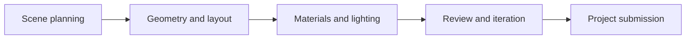

# 3D Visualization & Design | Coursework Submission

**A computational-graphics project submission, packaged milestone archive and design-decisions report.**

[Project archive](7-1_FinalProjectMilestones.zip) · [Design decisions](Final%20Project%20Design%20Decisions.docx) · [Other projects](https://github.com/xtyledan)

## Project process

*Diagram of the described design process; not a screenshot of the final 3D scene.*

## What this work explores

The submission reflects a graphics workflow involving scene composition, transformations, rendering choices, visual quality and iterative refinement. The packaged milestone archive and design document are the primary artifacts.

## Files

| Artifact | Contents / role |
| --- | --- |
| [7-1_FinalProjectMilestones.zip](7-1_FinalProjectMilestones.zip) | Course-submitted project archive |
| [Final Project Design Decisions.docx](Final%20Project%20Design%20Decisions.docx) | Design decisions and project reflection |
| README.md | Artifact overview and access instructions |

## How to inspect

1. Download `7-1_FinalProjectMilestones.zip` and extract it to a local folder.
2. Open the design-decisions DOCX for the documented creative and technical rationale.
3. Identify the actual tools, source files and dependencies from the extracted contents before attempting a build.

This repository's root does not include an extracted source tree or a verified run command. **The ZIP contents have not been validated for a fresh-machine build**, so an exact compiler or launch instruction would be speculative.

## Engineering decisions

- Iterate from a defined visual goal instead of adjusting a scene without requirements.
- Consider rendering complexity alongside visual clarity.
- Separate visual composition questions from implementation and performance questions.
- Document the decisions and tradeoffs made during development.

## Current limits

No verified executable, live 3D preview, application screenshot or automated test status is included at the repository root. Future improvements depend on confirming publishable source and producing an authentic scene capture from the original project.

**Type:** Packaged graphics coursework and design documentation.
